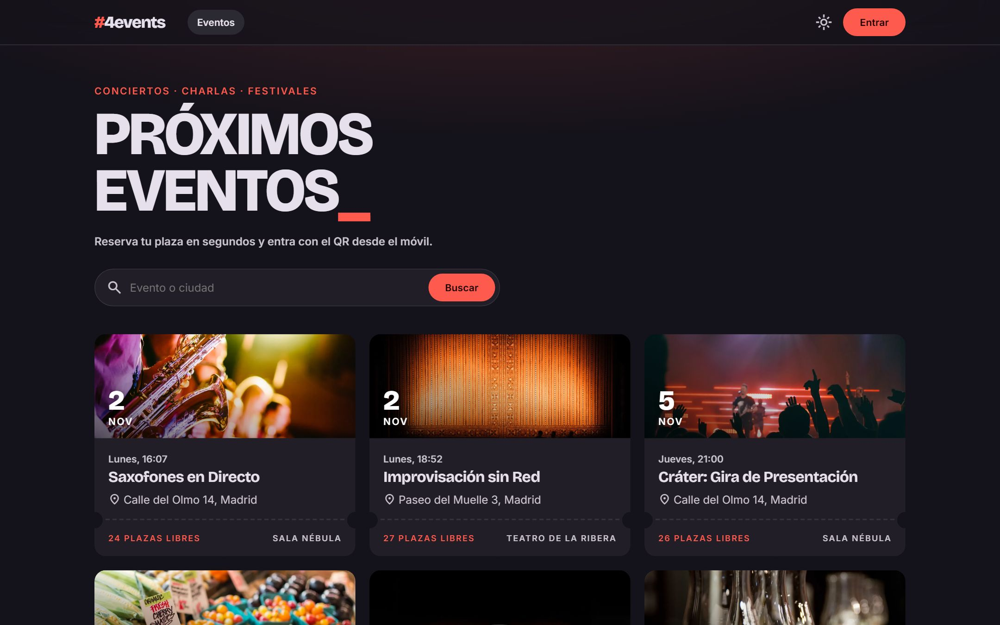
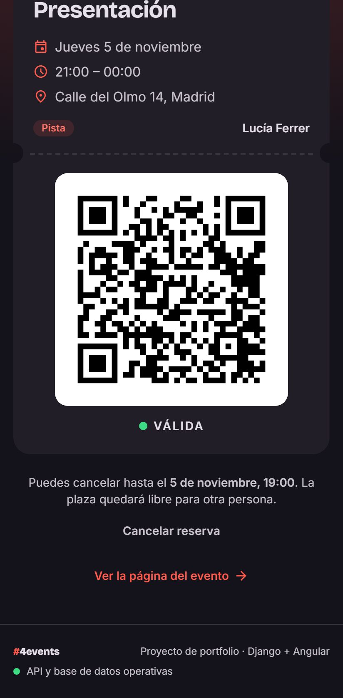
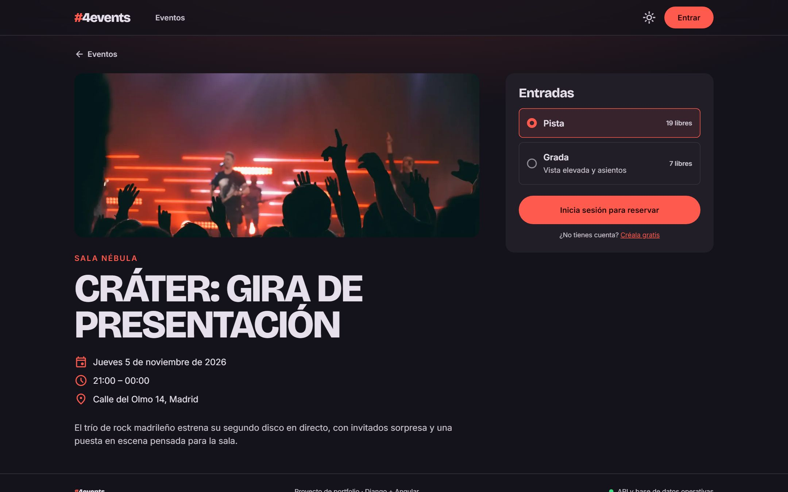
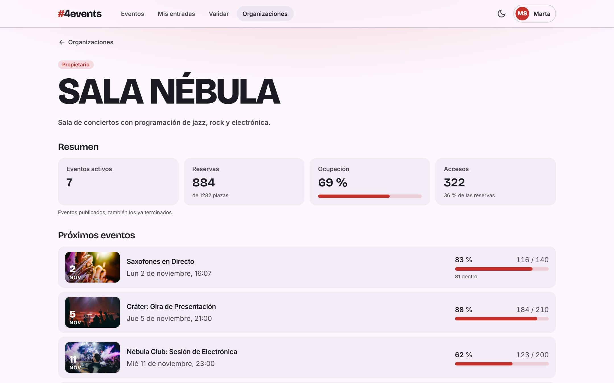
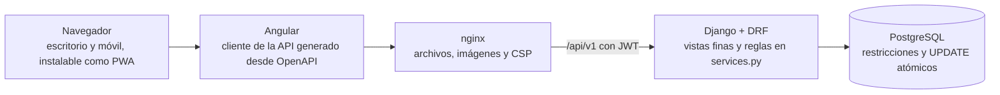

# eventos-django

[](https://github.com/milionhub/eventos-django/actions/workflows/backend.yml)
[](https://github.com/milionhub/eventos-django/actions/workflows/frontend.yml)
[](https://github.com/milionhub/eventos-django/actions/workflows/e2e.yml)
[](https://github.com/milionhub/eventos-django/actions/workflows/demo.yml)

**#4events** es una plataforma de eventos y entradas con QR: los organizadores publican eventos, los asistentes reservan desde el móvil y el personal valida los accesos con la cámara.

Es un proyecto de portfolio para aprender Django y Angular a fondo. Su parte más cuidada es lo que suele fallar sin avisar: **que no se reserven más plazas de las que hay y que una entrada no entre dos veces**, aunque todo ocurra a la vez.

**Stack:** Angular 22 · Django 5.2 · Django REST Framework · PostgreSQL 17 · Docker · Playwright



| Mis entradas | La entrada | El escáner | El resultado |
|---|---|---|---|
|  |  |  |  |

<details>
<summary>Más capturas</summary>

| Reservar | Panel del organizador |
|---|---|
|  |  |

Hay [una captura de cada pantalla](docs/screenshots/).
</details>

## Pruébalo

Solo necesitas [Docker](https://www.docker.com/products/docker-desktop/):

```bash
docker compose --profile demo up --build -d --wait
```

Abre **http://localhost:8180**. La primera vez tarda varios minutos, porque construye las imágenes y carga los datos de demostración.

La contraseña de todas las cuentas es `Demo-Eventos-2026`:

| Cuenta | Para ver |
|---|---|
| `marta@demo.test` | Organizadora: dashboard, estadísticas, asistentes y CSV |
| `hugo@demo.test` | Personal de acceso: el escáner, con un evento en curso |
| `lucia@demo.test` | Asistente: entradas válidas, usadas y canceladas |
| `admin@demo.test` | Administradora, en `/admin/` |

Las fechas se fijan al crear los datos. Para pararla, `docker compose --profile demo down`; añade `-v` para borrar los datos y regenerarlos con fechas de hoy al volver a arrancar. La demo solo escucha en tu equipo y sus contraseñas son públicas: no es un despliegue real.

## Arquitectura



Un monolito modular con apps por dominio: `accounts`, `organizations`, `events`, `ticketing` y `checkin`. Hay cinco roles, de visitante a propietario, y todos los permisos se comprueban en el backend. Pagos, listas de espera y emails quedan fuera del alcance. Más en [Arquitectura y API](docs/architecture.md) y [Requisitos y permisos](docs/requirements.md).

## Lo más interesante

- **Sin sobreventa.** Reservar es un único `UPDATE` condicional. Con «leer y escribir», las 50 personas de la prueba reservaban en un cupo de 10. [Cómo se resolvió, y el deadlock que encontraron los tests](docs/decisiones-tecnicas.md#reservas-sin-sobreventa).
- **Una entrada no entra dos veces.** Un `UPDATE` con subconsulta validaba dos veces la misma entrada, en 10 de 10 pruebas. [La trampa de PostgreSQL](docs/decisiones-tecnicas.md#una-entrada-no-entra-dos-veces).
- **Cifras que cuadran.** Una consulta natural de Django daba 60 plazas en lugar de 15, sin ningún error. [Por qué y cómo se evita](docs/decisiones-tecnicas.md#cifras-que-cuadran-y-un-csv-que-no-se-puede-usar-contra-ti).
- **Sesiones.** Token de acceso en memoria y refresh con rotación en cookie `httpOnly` ([ADR-0003](docs/adr/0003-autenticacion-jwt.md)), con un margen para no cerrar la sesión al navegar ([ADR-0009](docs/adr/0009-margen-rotacion-refresh.md)).
- **Seguridad revisada.** Acceso a otra organización siempre con 404, límites de peticiones que no se saltan con cabeceras falsas y CSP sin scripts en línea. [La revisión completa](docs/security.md).

## Cómo se comprueba

- **Más de 400 tests en el backend**, siempre contra PostgreSQL y con cobertura por ramas del 99 %. Los de concurrencia lanzan peticiones simultáneas.
- **Los 5 recorridos completos con Playwright**, en escritorio y móvil emulado, más accesibilidad WCAG 2.1 AA con axe y uso solo con teclado.
- **La CI** ejecuta todo esto, audita las dependencias y arranca la demo desde cero con el comando de arriba.
- **A mano**, en un iPhone real y en Chrome sobre un emulador de Android.

## Documentación

- [Desarrollo: instalar, tests y comandos](docs/desarrollo.md)
- [Decisiones técnicas en detalle](docs/decisiones-tecnicas.md) y [ADR](docs/adr/README.md)
- [Modelo de datos](docs/data-model.md) · [Identidad visual](docs/design.md) · [Wireframes](docs/wireframes.md)
- [Probar el escáner en un móvil](docs/guia-movil.md) · [ROADMAP](docs/ROADMAP.md)

## Licencia

[MIT](LICENSE)
