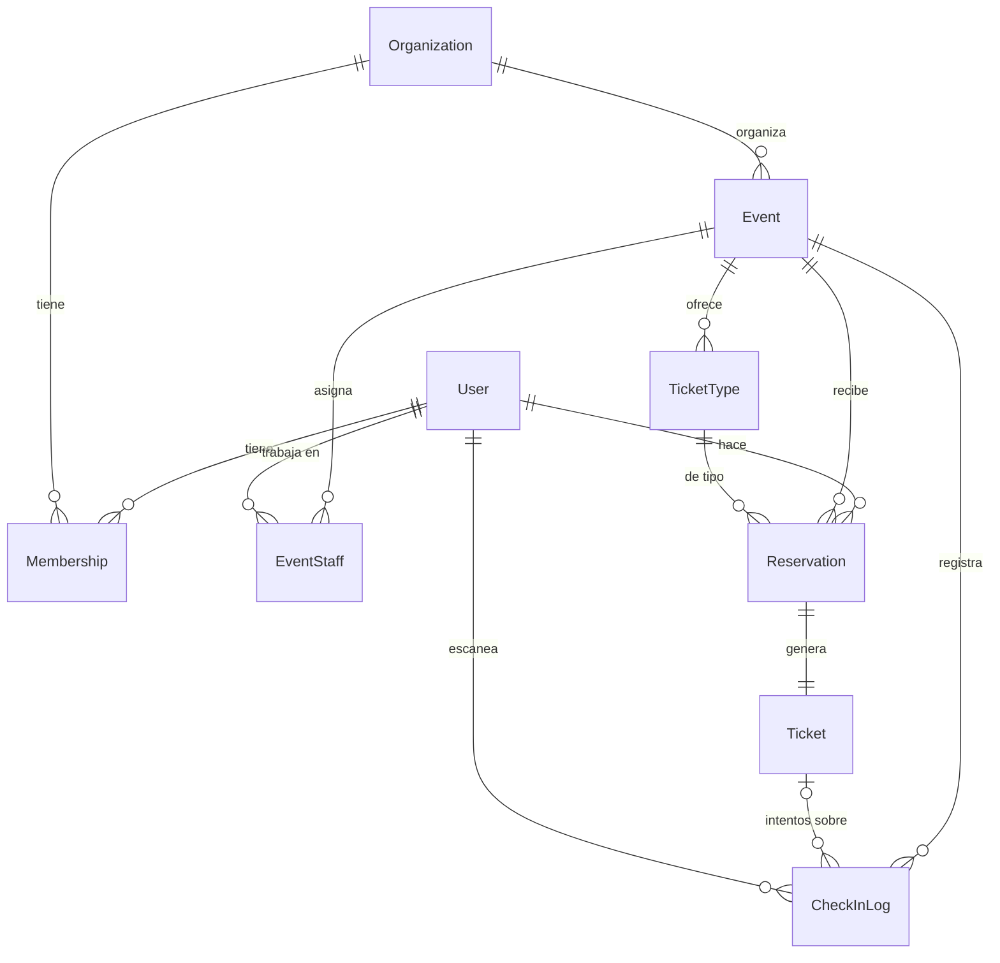

# Modelo de datos

> Estado: **borrador Fase 0**. Las reglas RN-xx están en `requirements.md`.

## Diagrama



## Convenciones

- PK `BigAutoField` por defecto. **UUID** como PK en `Reservation` y `Ticket`, porque sus IDs aparecen en URLs del asistente y no deben ser enumerables.
- Todas las tablas llevan `created_at` y las editables también `updated_at`, mediante un modelo abstracto `TimeStampedModel`.
- Los enums son `TextChoices` de Django.
- Las FKs usan `on_delete=PROTECT` salvo que se indique lo contrario: en el MVP no se borran datos con historial.

---

## accounts

### User (`AbstractUser` sin `username`)

| Campo | Tipo | Notas |
|---|---|---|
| id | BigAuto | |
| email | Email | **único**, `USERNAME_FIELD`, normalizado a minúsculas |
| first_name / last_name | Char(150) | |
| password, is_active, is_staff, is_superuser, date_joined, last_login | (heredados) | |

---

## organizations

### Organization

| Campo | Tipo | Notas |
|---|---|---|
| id | BigAuto | |
| name | Char(120) | |
| slug | Slug(140) | **único**, se genera a partir de `name` |
| description | Text | opcional |
| created_at / updated_at | DateTime | |

### Membership

| Campo | Tipo | Notas |
|---|---|---|
| id | BigAuto | |
| user | FK User | `CASCADE` |
| organization | FK Organization | `CASCADE` |
| role | Choices | `OWNER` / `MANAGER` / `STAFF` |
| created_at | DateTime | |

**Restricciones:** `UniqueConstraint(user, organization)`.
**Reglas en servicio:** siempre ≥ 1 OWNER (RN-04).

---

## events

### Event

| Campo | Tipo | Notas |
|---|---|---|
| id | BigAuto | |
| organization | FK Organization | |
| title | Char(200) | |
| slug | Slug(220) | **único global**; URL pública `/events/<slug>` |
| description | Text | |
| location | Char(255) | texto libre |
| image_url | URL | opcional (sin subida de ficheros en el MVP) |
| start_at / end_at | DateTime (UTC) | |
| capacity | PositiveInteger | aforo total |
| status | Choices | `DRAFT` / `PUBLISHED` / `CANCELLED` |
| published_at / cancelled_at | DateTime null | |
| created_by | FK User | |
| created_at / updated_at | DateTime | |

**Restricciones:**
- `CheckConstraint(end_at > start_at)`
- `CheckConstraint(capacity > 0)`

**Índices:** `(status, start_at)` para el listado público; `(organization, start_at)`.

### TicketType

| Campo | Tipo | Notas |
|---|---|---|
| id | BigAuto | |
| event | FK Event | |
| name | Char(80) | |
| description | Char(255) | opcional |
| capacity | PositiveInteger | cupo de la categoría |
| reserved_count | PositiveInteger | **contador desnormalizado**, por defecto 0 |
| created_at / updated_at | DateTime | |

**Restricciones:**
- `UniqueConstraint(event, name)`
- `CheckConstraint(reserved_count <= capacity)` ← última barrera contra la sobreventa
- `CheckConstraint(reserved_count >= 0)`

**Regla en servicio:** `sum(capacity) ≤ event.capacity` (RN-13).

### EventStaff

| Campo | Tipo | Notas |
|---|---|---|
| id | BigAuto | |
| event | FK Event | `CASCADE` |
| user | FK User | `CASCADE` |
| created_at | DateTime | |

**Restricciones:** `UniqueConstraint(event, user)`.
**Regla en servicio:** el usuario debe ser miembro de la organización del evento.

---

## ticketing

### Reservation

| Campo | Tipo | Notas |
|---|---|---|
| id | UUID | |
| user | FK User | |
| event | FK Event | desnormalizado desde `ticket_type` para poder aplicar la restricción |
| ticket_type | FK TicketType | |
| status | Choices | `CONFIRMED` / `CANCELLED` |
| cancelled_at | DateTime null | |
| cancelled_by | FK User null | quién canceló (el asistente o un organizador) |
| created_at / updated_at | DateTime | |

**Restricciones:**
- `UniqueConstraint(user, event, condition=Q(status=CONFIRMED))` ← RN-17. Es un índice único **parcial** de PostgreSQL.

**Índices:** `(event, status)`.

### Ticket

| Campo | Tipo | Notas |
|---|---|---|
| id | UUID | |
| reservation | OneToOne Reservation | en el futuro pasará a ser FK si se admiten N entradas por reserva |
| token | Char(64) | **único**, `secrets.token_urlsafe(32)` |
| status | Choices | `VALID` / `USED` / `CANCELLED` |
| issued_at | DateTime | |
| checked_in_at | DateTime null | |
| checked_in_by | FK User null | |

**Índices:** el `token` único ya lleva índice (es la búsqueda del check-in).

---

## checkin

### CheckInLog (solo inserciones)

| Campo | Tipo | Notas |
|---|---|---|
| id | BigAuto | |
| event | FK Event | evento en el que se escaneó |
| ticket | FK Ticket **null** | nulo si el token no existe |
| staff | FK User | quién escaneó |
| result | Choices | `VALID` / `ALREADY_USED` / `CANCELLED` / `NOT_FOUND` / `WRONG_EVENT` / `EVENT_NOT_ACTIVE` / `UNAUTHORIZED` |
| checked_at | DateTime | |

**Índices:** `(event, checked_at)`.
No se guarda el token escaneado cuando no corresponde a ninguna entrada: evita almacenar datos arbitrarios.

---

## Operaciones críticas (resumen; detalle en ADR-0004)

**Reservar** (`transaction.atomic`):
```python
updated = TicketType.objects.filter(
    pk=ticket_type_id, reserved_count__lt=F("capacity")
).update(reserved_count=F("reserved_count") + 1)
if not updated:
    raise SoldOut
# crear Reservation + Ticket; si salta el UniqueConstraint → AlreadyReserved (se hace rollback del contador)
```

**Validar entrada:**
```python
updated = Ticket.objects.filter(
    token=token, status=Ticket.Status.VALID, reservation__event=event
).update(status=Ticket.Status.USED, checked_in_at=now, checked_in_by=staff)
# updated == 1 → VALID; si es 0, se lee el ticket para distinguir el motivo del rechazo
```
